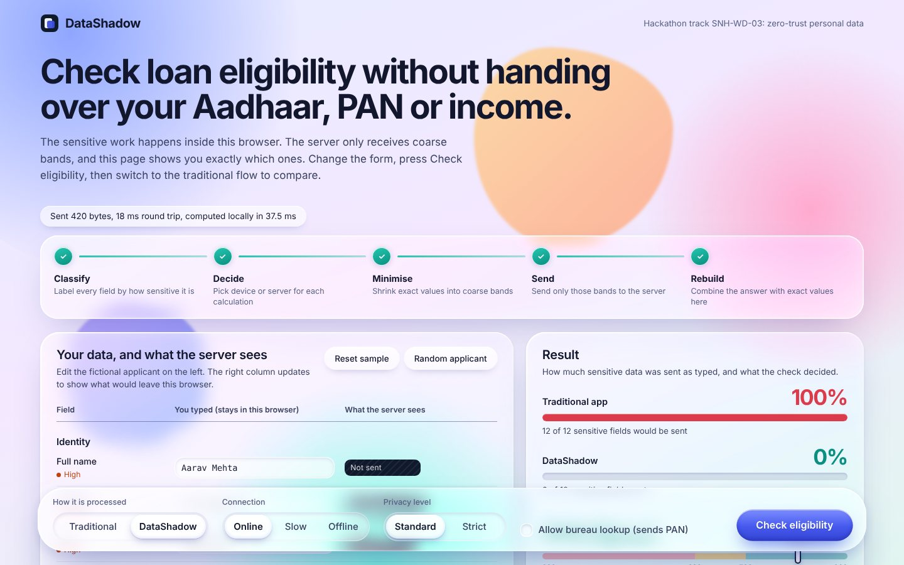
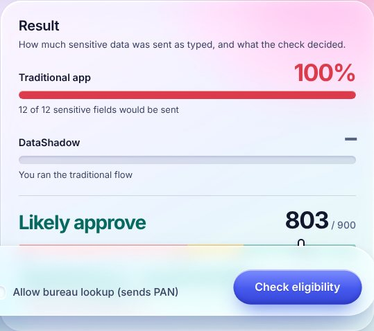
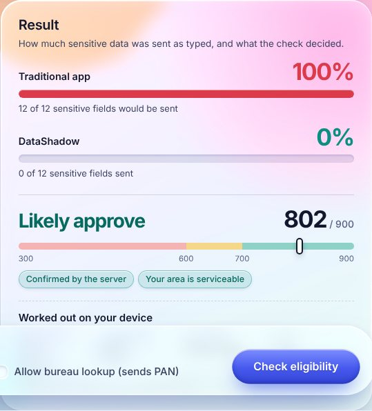
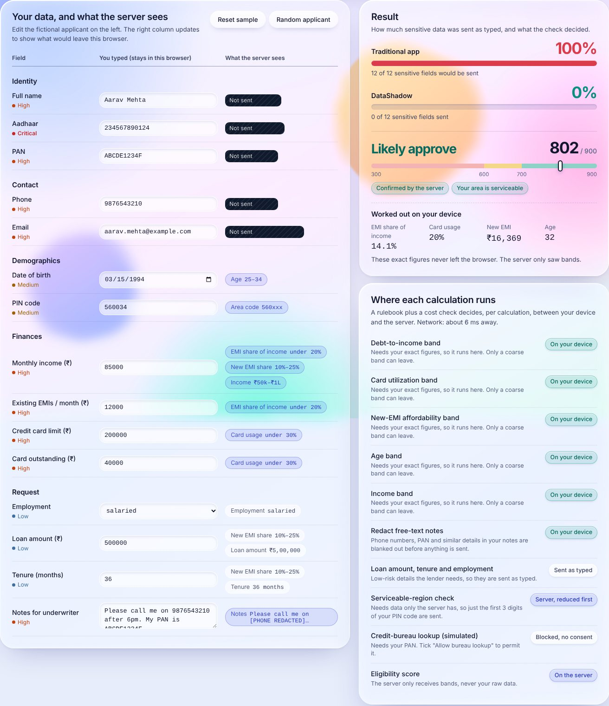
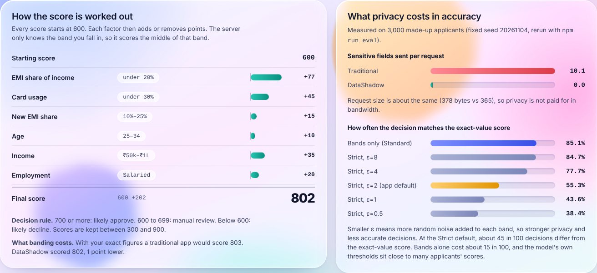
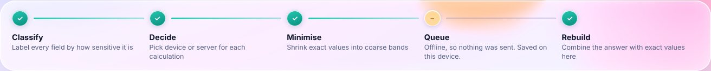
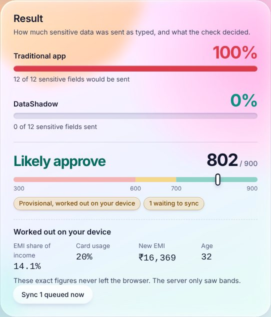
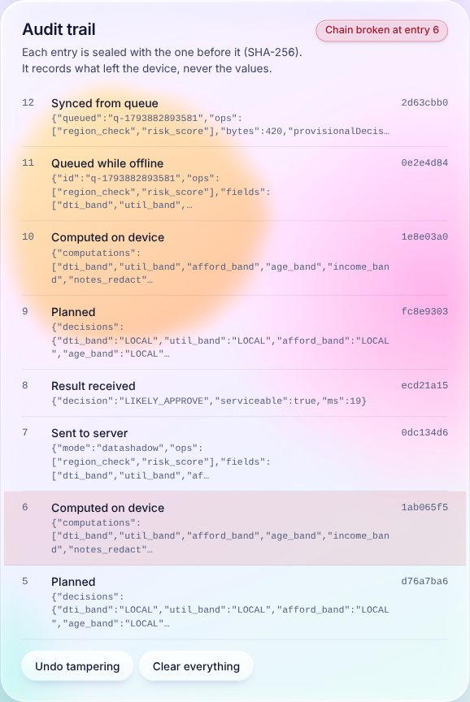

<div align="center">

# DataShadow

### Check a loan application without the server ever seeing<br>the applicant's Aadhaar, PAN or income.

Zero-trust personal data architecture for the web &nbsp;·&nbsp; **Hackathon track SNH-WD-03**

<p>
  <a href="https://YOUR-APP.onrender.com"></a>
  <a href="https://YOUR-VIDEO-LINK"></a>
  <a href="docs/DEMO.md"></a>
</p>

<p>
  
  
  
  
  
  
</p>



</div>

---

## The 30-second version

**Problem.** A loan app asks for your Aadhaar, PAN, phone, income and card balances, posts all of it to a server, and keeps it. To answer one question, "are you likely to be approved?", the server collects a full profile that it now has to protect, audit and disclose. Every database that holds it becomes a breach target.

**Idea.** The server needs a *score*, not a *profile*. So the sensitive work happens in your browser. Your device classifies every field, decides which calculations stay local, shrinks exact values into coarse bands, and sends only those. The server scores the bands and replies. Your browser then combines the answer with your exact figures, so you still get a precise result.

**Result**, measured on 3,000 synthetic applicants:

| | Traditional app | DataShadow |
|---|---|---|
| Sensitive fields sent per request (avg) | **10.1** | **0** |
| Request size (avg) | 378 B | 365 B |
| Same decision as the exact-value model | 100% (it *is* the exact model) | **85.1%** with bands only |

Privacy is not paid for in bandwidth. It is paid for in accuracy, and this project measures that cost and shows it on screen instead of hiding it (see [Honest trade-offs](#honest-trade-offs)).

---

## See it work

**Same applicant, two architectures.** The leak meter counts the real bytes of sensitive values found in the request that was actually sent, including values hidden inside free text.

| Traditional app | DataShadow |
|---|---|
|  |  |

**The inspector.** Left: what the user typed, which never leaves the browser. Right: exactly what the server would see for each field. Aadhaar, PAN, phone and email are *Not sent*; numbers become bands; the free-text note has its phone number and PAN redacted. The planner on the far right says, per calculation, where it ran and why.



**Explainable score, and the honest cost of privacy.** Every point is traceable to a band, and the panel shows what an app with exact values would have scored.



**Works with no connection.** Offline, nothing leaves the device. A provisional score is computed locally, and a derived-only request is queued. When the connection returns, it syncs by itself.




**Tamper-evident audit trail.** Every step is sealed with the SHA-256 hash of the one before it. Edit any past entry and the chain breaks from that point on.



---

## How it works

```
 raw profile ──► classifier ──► policy engine ──► planner ──► local compute (Web Worker)
 (never leaves)   field + value    per-field rule    LOCAL or      bands / redaction / optional ε-LDP
                  + free-text scan (R1 to R7)        REMOTE?                 │
                                                                             ▼
 result ◄── reconstruct on device ◄── server scores BANDS ◄── allowlisted minimal payload
 (exact figures computed locally)    (never raw data)         (+ hash-chained audit entry)
```

### Every requirement of the track, and where it lives

| Track requirement | How it is met | Code |
|---|---|---|
| Identify sensitive fields | Classifies by field name *and* by value: Verhoeff-validated Aadhaar, PAN, phone and email patterns, plus a PII scan of free text | `packages/core/src/classifier.js` |
| Classify computations | Each computation declares its inputs, whether it can run on either side, and its cost | `computations.js` |
| Decide local vs remote | Hard constraints from policy, consent and connectivity first, then a weighted cost score. Every decision carries its reasons and the alternative it rejected | `planner.js` |
| Transform before transmission | Bands, PIN-code prefix, redaction, and optional ε-local differential privacy with a visible budget | `transforms.js`, `privacy.js` |
| Work under restricted connectivity | Provisional on-device score, deferred queue of derived-only payloads, automatic sync on reconnect | `pipeline.js`, `client/src/lib/runtime.js` |
| Reconstruct results without raw data | The server returns a band-based decision; exact figures are recomputed on the device | `pipeline.js#reconstruct` |
| Accountability | Hash-chained audit ledger of everything that left the device | `audit.js` |

### The policy: what may leave, per field

| Rule | Data | What the server can receive |
|---|---|---|
| R1 | Aadhaar | nothing, ever |
| R2 | PAN | only with explicit consent, only for the bureau lookup, and flagged in the audit trail |
| R3 | Name, phone, email | nothing |
| R4 | Date of birth | an age band |
| R5 | PIN code | the first 3 digits |
| R6 | Income, EMIs, card figures | bands |
| R7 | Free text containing PII | the text with PII redacted |

The server enforces this independently. It accepts only an allowlist of keys (`payload.js`), and anything else is rejected with HTTP 422 before any scoring happens. Error responses and logs carry key names and messages, never values, so a client bug cannot leak extra data.

### The planner: device or server, per calculation

For each calculation the planner builds two options, run it **locally** or run it **on the server**, then:

1. **Rules out options that break a constraint.** The server option is infeasible if it would need a raw financial figure, an identifier without consent, or if the device is offline. The local option is infeasible if the code does not exist on the device (for example the serviceable-region list lives only on the server).
2. **Scores what is left**: `privacy × risk + latency × min(1, time ÷ cap) + authority × provisional`, with weights 0.65, 0.35 and 0.25, and picks the lowest.
3. **Records why.** The decision (`LOCAL`, `PASSTHROUGH`, `REMOTE`, `REMOTE_TRANSFORMED`, `REMOTE_CONSENTED`, `LOCAL_FALLBACK`, `DEFERRED`, `BLOCKED_*`) is shown in the UI with its reasons, and the cost table for both options sits under *Technical detail*.

---

## How the numbers are calculated

**Leak % (the red and teal meters).** Sensitive fields are those the classifier rates medium or higher. For the sample applicant that is 12 fields, 164 bytes of text. The meter searches the request body for each of those exact values, including inside free text, and reports `bytes of sensitive values found ÷ 164`. A traditional request contains all of them, so 100%. With the optional bureau consent ticked, the PAN is sent as typed, which is 10 of 164 bytes, so 6.1%. The UI shows that rather than hiding it. Low-risk fields such as loan amount are credited to their own field, so a coincidental number match is not counted as a leak.

**The score (300 to 900).** The scoring model is a transparent set of curves, not machine learning. It starts at 600, adds or subtracts points per factor, and clamps the total. At 700 or above the decision is *Likely approve*, 600 to 699 is *Manual review*, below 600 is *Likely decline*. For the sample applicant:

| Factor | Band the server saw | Points |
|---|---|---|
| EMI share of income | under 20% | +77 |
| Card usage | under 30% | +45 |
| New EMI share | 10% to 25% | +15 |
| Age | 25 to 34 | +10 |
| Income | ₹50k to ₹1L | +35 |
| Employment | salaried | +20 |
| **Total** | 600 + 202 | **802** |

The server only knows the band, so it scores the middle of the band through the same curve a traditional app uses on the exact value. That is the only difference: with exact figures the same applicant scores 803.

---

## Results

Reproduce with `npm run eval` (seed `20261104`, 3,000 synthetic applicants, output in `docs/eval-results.json`).

**Leakage and size**

| | Traditional | DataShadow |
|---|---|---|
| Sensitive fields sent raw (avg) | 10.1 | **0** |
| Sensitive bytes sent raw (avg) | 119 B | **0 B** |
| Request size (avg) | 378 B | 365 B |

**Decision agreement with the exact-value model**

| Mode | ε per band | Agreement | Mean score error |
|---|---|---|---|
| Bands only (Standard) | none | 85.1% | 18.8 pts |
| Strict | 8 | 84.7% | 19.0 |
| Strict | 4 | 77.7% | 29.6 |
| Strict | 2 (UI default) | 55.3% | 64.4 |
| Strict | 1 | 43.6% | 86.2 |

### Honest trade-offs

- **Banding alone changes about 15% of decisions** compared with a model that sees exact inputs (4.9% false approvals, 1.7% false declines). The server scores the middle of each band, which can tip an applicant who sits near a decision threshold either way. Finer bands buy accuracy at the cost of less minimisation.
- **Strict mode is expensive.** Local differential privacy on one applicant's five features at ε=2 per band drops agreement to 55%. That is a real property of local DP on a single record, not a bug. The levers are a larger ε or finer bands. A production system would add shuffle or central DP, or secure aggregation, which this prototype does not implement.
- **Request size barely changes.** This profile is small. The gain is in *what* is in the request.

---

## Threat model

**Protects against:** a curious or breached server or database, server logs and analytics, and accidental over-collection by client code (the server allowlist).

**What the server still learns:** five bands, employment type, loan amount and tenure, a 3-digit PIN prefix, redacted notes and a session ID. Bands are quasi-identifiers. PIN prefix plus age band plus income band is far less identifying than the raw profile, but it is **not anonymous**.

**Out of scope:** a compromised browser or device, malicious extensions, network metadata (IP, timing, request size), and a client that lies about its bands. The server cannot verify that bands were computed honestly, and doing so would need attestation or zero-knowledge proofs, which are not implemented.

**Consented PAN:** when the user consents, the PAN is sent as typed over TLS. This is a deliberate, audited exception, not a privacy-preserving one.

**Simulated parts:** the credit-bureau response is a deterministic function of the PAN, not a real bureau call. The score is a demonstration pre-eligibility model, not a real credit score.

**On-device storage:** the raw profile is never written to storage. What is persisted: the privacy budget (with its memoised noisy releases), the audit ledger, and queued *derived-only* requests. A raw identifier is never queued, and a consented bureau lookup is not deferred while offline.

### Privacy mechanisms in one paragraph

**Banding** is the main minimisation: the server's model only needs bands, so nothing finer is sent. **Strict mode** adds k-ary randomized response: keep the true band with probability `e^ε / (e^ε + k − 1)`, otherwise report one of the other bands uniformly. That is ε-local differential privacy per released value, tracked against a visible total budget with basic sequential composition. Repeat releases of the same true value reuse the first noisy answer, so resubmitting the form cannot average the noise away.

---

## Run it

```bash
npm install
npm run dev        # API on :8788, UI on http://localhost:5174
npm test           # 34 core tests + 9 server tests
npm run eval       # regenerates docs/eval-results.json and the in-app chart data
npm run build && npm start   # one process serves API and UI on :8788
```

Requires Node 20 or newer. Try the controls at the bottom of the page: **Traditional / DataShadow**, **Online / Slow / Offline**, **Standard / Strict**, and the **bureau consent** checkbox. A guided 2-minute walkthrough is in [`docs/DEMO.md`](docs/DEMO.md).

### Deploy

One process serves the API and the built client, so there is a single URL to share.

- **Render (free):** push to GitHub, then New, Blueprint, and select the repo. `render.yaml` sets everything up. The free tier sleeps when idle, so open the link once before a demo.
- **Docker:** `docker build -t datashadow . && docker run -p 8788:8788 datashadow`
- **Any Node host:** `npm ci && npm run build && npm start`, setting `PORT` if the host requires it.

`/api/score-traditional` exists only to show the leaky baseline in the demo. Keep it on demo deployments only.

---

## Engineering quality

- **43 automated tests**, run on every push by GitHub Actions: classifier (including Verhoeff checksum validation, renamed fields and PII hidden in free text), transforms and privacy mechanisms, planner decisions under each network and consent state, the full pipeline, and the server API.
- **A property test over 400 random applicants** asserts that no raw sensitive value appears in any DataShadow request.
- **Deterministic evaluation:** seeded synthetic data, so every number in this README can be reproduced.
- **Defence in depth:** the client minimises, and the server independently rejects anything outside the allowlist.
- **Shared isomorphic core:** the same classifier, planner and model run in the browser, in a Web Worker, in the server and in the tests, so the behaviour you see is the behaviour that is tested.
- **Accessible UI:** radio groups with labels, live-region status updates, keyboard-operable controls, and reduced-motion support.

## Third-party technologies and AI use (disclosure)

React 18, Vite 5, Express 4, Node.js built-in test runner and WebCrypto. Playwright was used only during development to test the UI and capture the screenshots in this README. **No external AI models, APIs or datasets run at runtime.** The classifier, policy, planner, scoring model and privacy mechanisms are rule-based and live in `packages/core`. Applicant data is generated by `packages/core/src/synthetic.js`, and every profile in the project is fictional. AI-assisted development (Claude) was used to help write and test this codebase.

## Repository layout

```
packages/core    isomorphic logic: classifier, policy, planner, privacy, audit, model, tests
server           Express API: /api/score (allowlist), /api/score-traditional (baseline), /api/received
client           React UI, Web Worker for on-device compute, offline queue
scripts/eval.js  seeded evaluation
docs/            DEMO.md, eval-results.json, screenshots
```

## Roadmap

1. Adaptive bands and an accuracy-versus-minimisation slider.
2. Shuffle-model or secure-aggregation DP to recover accuracy at low ε.
3. Attested or zero-knowledge proofs that bands were computed honestly.
4. A Mongo-backed store (the `MemoryStore` interface is three methods).
5. An on-device NER model as a second opinion for free-text PII.
